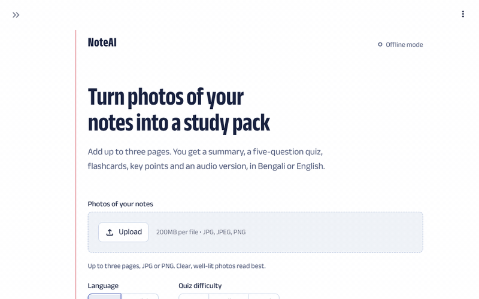
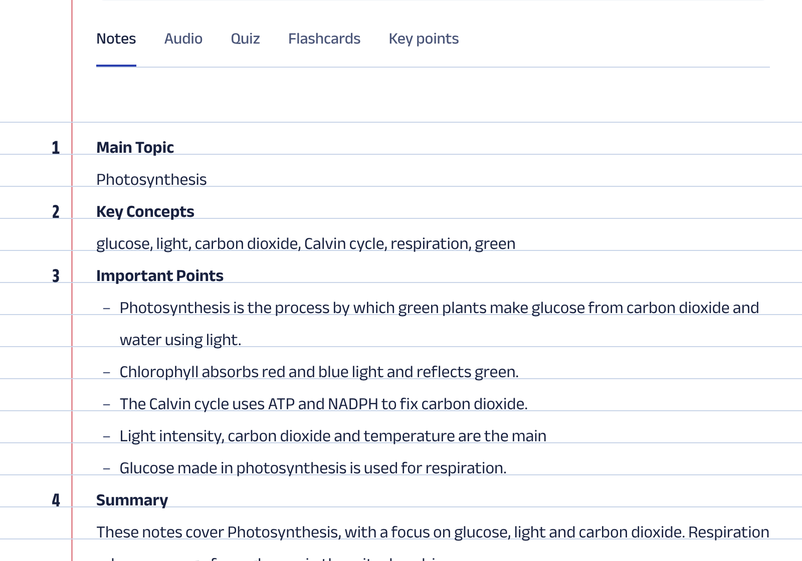
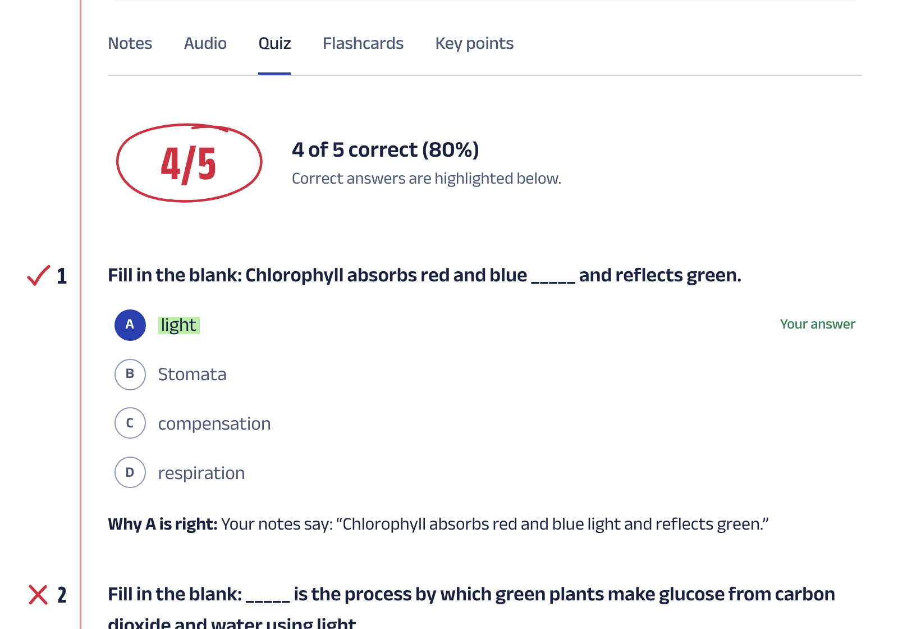
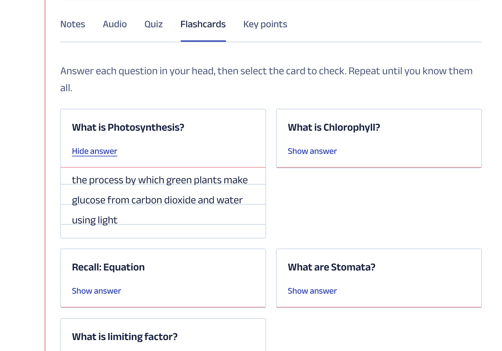
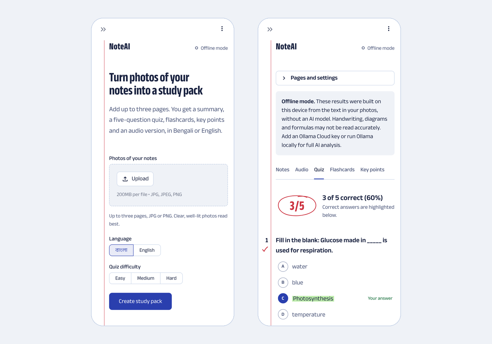
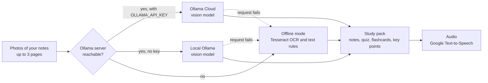

<div align="center">


# NoteAI

**Turn photos of your class notes into a study pack: a summary, a quiz, flashcards, key points and audio, in Bengali or English.**

[](https://note-ai-io.streamlit.app/)


[Live demo](https://note-ai-io.streamlit.app/) · [Features](#features) · [Quick start](#quick-start) · [Configuration](#configuration) · [Deployment](#deploy-to-streamlit-community-cloud)

<br/>



<sub>Recorded in offline mode, which reads the photos with Tesseract OCR instead of an AI model.</sub>

</div>

## Overview

NoteAI is a Streamlit app for students. Upload up to three photos of your handwritten or printed notes, and it writes them up as structured notes, a five-question quiz with explanations, flashcards and key points, then reads the notes aloud. The whole study pack can be produced in Bengali or English.

It runs with an [Ollama](https://ollama.com) vision model in the cloud or on your own machine, and it still works with no AI model at all: offline mode reads the text in your photos with Tesseract OCR and builds the study pack from it.

## Features

| Feature | What you get |
|---|---|
| **Notes** | Structured study notes (main topic, key concepts, important points, summary) from up to three photos |
| **Audio** | The notes read aloud in Bengali or English |
| **Quiz** | Five multiple-choice questions at Easy, Medium or Hard, marked instantly with an explanation for every answer; retake it or ask for new questions |
| **Flashcards** | Question-and-answer cards you open to check yourself |
| **Key points** | Main topics, formulas and definitions, and important facts at a glance |
| **Bengali and English** | One switch sets the language of the whole study pack, and the interface font covers both scripts |
| **Three ways to run** | Ollama Cloud, a local Ollama model, or offline mode with no model at all |
| **Export** | Download the notes, flashcards and key points as text files |

## Screenshots

<table>
  <tr>
    <td width="50%"></td>
    <td width="50%"></td>
  </tr>
  <tr>
    <td align="center"><sub><b>Notes</b> set on ruled lines, with section numbers in the margin</sub></td>
    <td align="center"><sub><b>Quiz</b> marked in red pen, with the score circled</sub></td>
  </tr>
  <tr>
    <td width="50%"></td>
    <td width="50%"></td>
  </tr>
  <tr>
    <td align="center"><sub><b>Flashcards</b> as index cards you open to check</sub></td>
    <td align="center"><sub><b>On a phone</b>, with the settings tucked into the sidebar</sub></td>
  </tr>
</table>

## How it works



NoteAI picks the mode automatically and shows it at the top of the page and in the sidebar.

| Mode | When | What happens |
|---|---|---|
| **Ollama Cloud** | `OLLAMA_API_KEY` is set | Photos are analysed by an [Ollama Cloud](https://ollama.com) vision model (`gemma4:31b` by default; pick any model in the sidebar). The hosted demo uses this mode. |
| **Local Ollama** | No key, and Ollama is running locally | Photos are analysed by a vision model on your own machine. |
| **Offline mode** | No key and no Ollama server | NoteAI reads the text in your photos with Tesseract OCR (English and Bengali) and builds the notes, key points, flashcards and a fill-in-the-blank quiz from it. It works best on printed or neatly written notes and can't interpret diagrams the way an AI model can. A banner marks offline results. |

If the AI model fails mid-session (network, quota or a wrong key), NoteAI shows a warning and falls back to offline results instead of stopping. Each part of the study pack is generated once per session and kept, and the quiz runs as an isolated fragment, so picking an answer never reloads the page.

### Tech stack

| Layer | Technology |
|---|---|
| Interface | [Streamlit](https://streamlit.io) with a custom theme and CSS |
| AI and vision | [Ollama](https://ollama.com): Ollama Cloud, or a local vision model such as `minicpm-v` |
| Offline mode | [Tesseract OCR](https://github.com/tesseract-ocr/tesseract) through `pytesseract`, plus extractive text rules |
| Text-to-speech | [gTTS](https://github.com/pndurette/gTTS) (Google Text-to-Speech) |
| Imaging | [Pillow](https://python-pillow.org) |

## Quick start

### Prerequisites

- Python 3.10 or newer
- One of: an Ollama Cloud API key, a local [Ollama](https://ollama.com) install, or [Tesseract OCR](https://github.com/tesseract-ocr/tesseract) for offline mode

### 1. Clone and install

```bash
git clone https://github.com/SHAYAN-ABRAR/NoteAI---AI-powered-study-companion.git
cd NoteAI---AI-powered-study-companion
pip install -r requirements.txt
```

### 2. Choose an AI mode

You can skip this step and run in offline mode.

**Ollama Cloud.** Create an API key at [ollama.com](https://ollama.com) (**Settings → API Keys**) and put it in a `.env` file in the project root:

```env
OLLAMA_API_KEY=your_ollama_api_key
```

**Local Ollama.** Install [Ollama](https://ollama.com) and pull a vision-capable model:

```bash
ollama pull minicpm-v
```

You can also configure it in `.env`:

```env
OLLAMA_BASE_URL=http://localhost:11434
OLLAMA_MODEL=minicpm-v:latest
OLLAMA_TIMEOUT=240
OLLAMA_IMAGE_MAX_SIZE=1280
```

**Offline mode.** Install Tesseract with the English and Bengali language data:

```bash
sudo apt install tesseract-ocr tesseract-ocr-eng tesseract-ocr-ben   # Debian/Ubuntu
brew install tesseract tesseract-lang                                 # macOS
```

On Windows, use the [Tesseract installer](https://github.com/UB-Mannheim/tesseract/wiki), tick Bengali under additional languages, and add the install folder to `PATH`.

### 3. Run

```bash
python -m streamlit run app.py
```

The app opens at `http://localhost:8501`. Add your photos, choose a language and a quiz difficulty, then select **Create study pack**. With Ollama running, you can switch between installed models in the sidebar.

## Configuration

Settings are read from Streamlit secrets first, then from environment variables or `.env`.

| Variable | Default | Description |
|---|---|---|
| `OLLAMA_API_KEY` | — | Ollama Cloud API key. When set, NoteAI uses Ollama Cloud |
| `OLLAMA_BASE_URL` | `https://ollama.com` with a key, otherwise `http://localhost:11434` | Ollama server address |
| `OLLAMA_MODEL` | `gemma4:31b` with a key, otherwise `llava` | Vision model used for note images |
| `OLLAMA_TIMEOUT` | `120` | Generation timeout (seconds) |
| `OLLAMA_IMAGE_MAX_SIZE` | `1280` | Max image dimension sent to the model (px) |
| `OLLAMA_NUM_PREDICT` | `700` | Max tokens per generation |

The interface theme is defined in `.streamlit/config.toml`. That file also turns on static file serving, which the app needs to load its bundled font from `static/fonts`.

## Deploy to Streamlit Community Cloud

1. Create the app at [share.streamlit.io](https://share.streamlit.io) from this repository, branch `main`, main file `app.py`.
2. In **App settings → Secrets**, add your key (TOML):
   ```toml
   OLLAMA_API_KEY = "your_ollama_api_key"
   ```
3. `packages.txt` installs Tesseract on the server, so the app still works in offline mode if the key is missing or the AI is unavailable.

> [!WARNING]
> A public app uses your API key, so visitors spend your Ollama quota.

## Project structure

```text
.
├── app.py                   Streamlit interface: upload, study pack tabs and quiz
├── api_calling.py           Ollama requests (cloud or local), audio and quiz parsing
├── offline_mode.py          OCR and the rules that build a study pack without a model
├── static/
│   ├── favicon.png
│   └── fonts/               Anek Bangla font and its licence
├── .streamlit/config.toml   Theme and static file serving
├── docs/media/              README images and demo
├── requirements.txt         Python dependencies
├── packages.txt             System packages for Streamlit Community Cloud (Tesseract)
├── .devcontainer/           Dev container for GitHub Codespaces
├── working_image.py         Standalone test of the Ollama image call
└── working_with_audio.py    Standalone test of gTTS audio
```

## Interface design

The interface is laid out like a page from an exercise book, using a Streamlit theme and a small amount of custom CSS:

- A red margin rule runs down the page; question numbers, section numbers and marks sit in the margin
- Notes and key points are set on ruled lines, and bold terms in the key points are marked in highlighter
- Quiz answers are answer-sheet bubbles that fill when chosen; after checking, wrong answers are struck through in red, correct ones are highlighted, and the score is circled in red pen
- Flashcards are index cards you open to reveal the answer
- [Anek Bangla](https://github.com/EkType/Anek) covers both Bengali and English and is self-hosted, so the design also works offline
- Light, high-contrast colours, visible keyboard focus, and reduced motion respected

## Privacy

- **Local Ollama and offline mode**: your note photos are processed on the machine running the app.
- **Ollama Cloud**: your note photos are sent to Ollama Cloud for analysis.
- **Audio**: the audio tab uses Google Text-to-Speech, so the generated note text is sent to Google to create the speech.

Speed depends on your hardware (local) or your connection (cloud) and on the model you choose.

## Roadmap

- [ ] PDF upload support
- [ ] Progress tracking across sessions
- [ ] Spaced-repetition flashcard mode
- [ ] More languages
- [x] Mobile-friendly layout

## Acknowledgements

The interface font is [Anek Bangla](https://github.com/EkType/Anek) by Ek Type, used under the SIL Open Font License 1.1 (see `static/fonts/OFL.txt`).

<div align="center">
<br/>

**Made for students, by a student.** If NoteAI helps you study, consider giving it a star.

</div>
